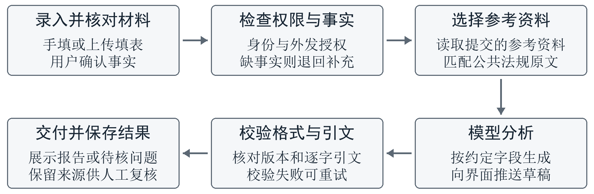

# 小知知识产权合规助理详细技术文档

小知是一款面向研发团队和法务人员的网页智能体，用于产品发布、技术合作和研发成果保护中的知识产权初筛。以产品上线前的宣传图审核为例，研发人员整理拟用图片、作品来源和许可材料，先做比对，再核对权属、使用方式和授权范围。法务人员沿报告引文回查原文，补齐缺失事实，再根据双方约定起草许可协议。项目提供在线工作区和本地运行方式，操作示例见第 6 节。

## 1 技术路线与业务流程

### 1.1 四个业务入口

| 入口 | 用户需要提供什么 | 系统交付什么 |
| --- | --- | --- |
| 检索对比 | 两方标识或作品，以及类别、渠道、地域、时间等背景 | 按要素对照两方材料，并列出差异与证据缺口。专利分支生成检索式并初筛用户回填的候选。 |
| 侵权识别 | 权利基础、被诉行为、发生时间、许可关系、警告和已采取措施 | 按商标、著作权或商业秘密的不同要素梳理风险。关键字段缺失时列出待补事实。 |
| 合规提示 | 研发阶段、拟发布的成果、开源组件及其使用方式，或待审条款 | 生成阶段清单、风险理由和下一步行动，可处理职务发明、保密、竞业和许可等事项。 |
| 知产文书 | 当事人角色、成果范围、期限、地域、价款及归属要求 | 生成保密、许可、职务发明或竞业限制协议初稿。缺项留待填写，供双方逐条核对。 |

### 1.2 从材料到报告

用户可以手填表单，也可以选择「上传文件填表」。系统读取文档正文，将图片或扫描页交给支持视觉输入的模型。服务端将抽取结果限制在所选业务的事项和字段内，前端把结果填回可编辑表单。审核宣传图时，用户可在提交前核对许可的期限、渠道和用途，把“已收到图片”与“已获得商业使用许可”区分开。

用户确认事实后，系统从启用的知识库中选取资料。模型按约定字段输出风险等级、结论、分析、引文、追问和行动建议，后端检查输出结构及公共法规引文。生成中的正文标为草稿，完成后展示报告和来源。文书、清单及相应业务报告可导出 Markdown 或 Word。

普通对话适合先提问或继续追问。首页四个示例可填入输入框，用户仍可修改。回形针、拖放、粘贴都向当前对话添加普通附件；如需把材料拆解成业务字段，应选择「上传文件填表」。

### 1.3 业务设计与创新点

侵权识别先查关键事实是否齐全。以宣传图审核为例，如果许可情况还未填写，程序先返回待补问题，法务可以据此向素材提供方索要授权文件。进入模型分析后，程序再检查引文是否逐字出自本次可引用的公共条文。两次检查分别对应材料完整性和出处可靠性，法务仍需判断法条如何适用于具体事实。

专利实施自由（FTO）初筛将检索式编辑与外部专利检索接起来。候选评级由浏览器根据用户确认的技术特征计算，每条候选都能回查命中的词、数据来源和复核备注，便于研发与法务分工核对。

## 2 模型与框架选型

### 2.1 模型按任务选择

| 模型 | 应用中的任务 | 选择依据 |
| --- | --- | --- |
| 智谱 GLM-4.7 | 文本问答、要素分析和文书起草 | 工作区初始选择，用于多要素的分析和正文生成。 |
| 智谱 GLM-4.7-Flash | 文本问答和材料字段提取 | 为短文本任务提供可选的轻量型号。 |
| 智谱 GLM-4.6V-Flash | 截图、商标图样及扫描页填表 | 内置注册表中支持图片输入的型号。 |

内置模型由服务端配置后启用，实际调用取决于供应商账号、额度和网络。自定义模型使用 OpenAI 兼容的流式对话协议，用户配置公网 HTTPS 地址、模型 ID、API Key 及图片或工具能力。连通测试发送固定短消息。每次业务请求沿用该次选定的模型，图片能力不足会提示重新选择。项目直接调用模型 API，业务适配由表单、任务提示、资料检索和结果核验完成。

### 2.2 组件与选择依据

| 层次 | 主要组件 | 在本项目中的用途 |
| --- | --- | --- |
| 交互与构建 | React 19、TypeScript、Vite、Tailwind CSS、Radix UI | 维护每个对话的输入草稿、附件和生成状态，复用表单和弹窗，打包桌面及窄屏页面。 |
| 服务与协议 | Node.js 22、Express 4、Zod、SSE | 本地与 EdgeOne 共用应用工厂；校验输入和模型结构化输出，向浏览器逐步传送正文与工具状态。 |
| 文档处理 | PDF.js、pdf-parse、Mammoth、word-extractor、JSZip | 分别处理浏览器 PDF 页面、服务端 PDF 文本、DOCX、旧 DOC 和 Word 报告打包。 |
| 身份与数据 | CloudBase Auth、PostgreSQL、私有对象存储 | 身份验证、关系库权限与版本检查分工处理，原文件单独保存，避免把文件字节直接塞入业务记录。 |

普通对话可调用计算器和日期时间工具。用户配置 Tavily Key 后，支持工具的模型可提交检索词并展示结果；事务台的今日知产新闻使用固定公开检索词，按北京时间筛选当天内容。网页搜索与结构化报告的法规核验使用不同的数据来源。

业务表单、专利筛选和报告核验的入口分别位于 `shared/workflow-fields.mjs`、`frontend/src/lib/fto.ts` 和 `backend/src/modules/agent/workbench-report.ts`。依赖版本和软件包来源见根目录 `package-lock.json`，开源依赖与第三方服务的出处见第 7 节。

## 3 系统架构与运行时序

| 架构层 | 入口或实现位置 | 职责 |
| --- | --- | --- |
| 入口层 | 登录页、对话框、知识库、事务台 | 登录后进入私有工作区；选择模型、材料及任务，管理对话与项目。 |
| 能力层 | 普通对话、四类知产业务、合同面板、文档工具 | 分流到交互式检索、规则筛选、模型分析、字段抽取或分段翻译。 |
| 数据层 | 公共法规目录、个人记录、私有文件桶、浏览器内存 | 区分可核验法源、用户事实、账号设置、原件和临时专利候选。 |
| 技术层 | React 客户端、Express API、CloudBase、模型与可选搜索服务 | 浏览器持登录令牌访问网关；后端验证身份和授权后调用选定服务。 |
| 输出层 | 流式回答、核验后的报告、引用链接、导出文件 | 保存对话和生成状态；专利初筛由用户导出候选、映射和复核备注。 |

### 3.1 一次报告请求如何完成

图 1 结构化报告生成流程

1. 前端组装表单事实和资料，先保存用户消息及回答占位，再向 `POST /api/agent/chat` 提交会话 ID、回答 ID、所选模型与业务模式。
2. Express 核对登录令牌、模型能力和账号的模型外发授权，使用 `begin_chat` 登记本次生成，避免同一对话同时写入多次生成结果。不同对话可以分别运行。
3. 后端读取公共目录，用前端提交的参考资料与目录原文匹配，得到当前可引用的法规集合。侵权识别发现必填事实缺失时，直接返回补充问题。
4. 模型输出 JSON，后端通过 SSE 把已生成的正文以草稿形式送到界面。完整结果须通过字段校验及引文核对，界面随后用报告正文替换草稿。
5. 完成、取消或超时时，后端通过 `finish_chat` 尽力保存正文和状态。用户可在符合条件的中断回复中继续生成，服务端核对修订号和生成上下文后接续同一条消息。

### 3.2 专利 FTO 初筛

用户确认方案已公开、已申请或已脱敏，编辑必要特征、同义词和排除词，再将检索式复制到外部专利库自行检索。回填 CSV 或 TSV 后，浏览器读取列映射，按公开号去重，并在标题和摘要中匹配词项。

设有必要特征且全部命中时列为高优先级，命中部分选定特征列为中，未命中列为低。缺少公开号、正文信息或可用特征的记录标为待核验。界面保留命中理由和复核备注，使用者可按来源回查权利要求、法律状态与目标地域。

## 4 数据集与知识更新

### 4.1 公共法规快照

仓库内 `shared/law-library.json` 的更新标记为 2026-11-18。该快照含 26 组规范文本版本、共 144 条选编条文。相同法律的不同版本分别计入。另有 6 条历史案例资料和 8 条参考资料，与选编条文合计生成 158 条初始公共目录记录。后两类标为待核验，默认停用，检索上下文过滤旧参考标记。公开数量反映仓库初始化数据，已部署数据库可由管理员更新。

单条法规保存稳定 ID、标题、条文原文、条号、制定机关、版本、效力层级、施行起日、可选终止日、官方来源和更新日期。例如 `law-tm19-57` 将一条商标法原文与其特定版本绑定。目录来自项目列明的公开主管机关文本，包括国家知识产权局、最高人民法院、国家版权局等。官方出处可沿每条 `source_url` 回查。 [项目权威来源清单](项目升级文档/知识产权常用法规库_权威链接清单.md)

### 4.2 导入、召回与校验

维护者通过 `scripts/import-law-library.py` 按来源版本及选定条号提取文本，核对发布日期、施行区间、条文首尾和跨页分段。再用 `scripts/write-knowledge-seed.ts` 生成初始化 SQL。初始化仅补齐缺失 ID，已部署条文的订正需单独更新。旧版本继续保存，供追溯和日期边界测试使用。

前端先过滤未启用的条目和旧参考资料。公共法规按北京时间的当前日期筛选，施行起日计入，终止日当天起排除。其余条目按中文相邻双字、英文词项、标题和业务主题加权，最多选 16 条。业务报告后端检查模型给出的条目 ID 和逐字引文，并用目录记录补齐机关、版本与来源链接。格式或引文异常时至多重试一次。引文仍无法支撑结论时，报告给出「无法判断」；持续无法解析的结果会报错。

### 4.3 其他输入的来源与用途

| 数据 | 来源和保存位置 | 使用范围 |
| --- | --- | --- |
| 个人资料 | 用户自行创建的条目、对话和私有附件 | 作为本账号的材料或事实。个人条目可以编辑，与公共法源分开处理。 |
| 专利候选 | 用户自行取得并回填的外部数据库导出结果 | CSV/TSV 单次最多 8 MiB、5 万行；候选和备注在页面内存处理，可另存字段映射。 |
| 验收样本 | 测试脚本中的模拟账号、合成文书、图片、CSV 和模型应答 | 用于回归测试权限、解析、流式保存与引文处理，不参与模型训练。 |

## 5 安全与合规设计

### 5.1 账号隔离与资料访问

新用户填写账号名称、邮箱和密码，经邮箱验证完成注册后返回登录。已有用户可用邮箱验证码或邮箱／账号名称加密码登录。账号设置支持改名、验证新邮箱后换绑，以及用已绑定邮箱的验证码改密。设置登录名称后，侧栏显示该名称；未设置时显示邮箱。后端以登录令牌确定当前用户。PostgreSQL 以所有者、记录类型和记录 ID 区分私有记录，结合行级安全策略与受限 RPC 控制访问。文件桶同时检查所有者与账号目录前缀。公共目录向已登录用户提供读取权限，个人覆盖设置单独保存。

### 5.2 附件存储与模型外发

把附件拖入、粘贴或通过回形针选择后，客户端立即将原件写入 CloudBase 私有桶，为当前账号保存文件记录。普通文档再经后端提取文本；图片在浏览器生成预览和缩小的模型输入。移除输入框中的附件只会从本轮草稿撤下，已保存原件仍可在设置里下载。文件保存和模型外发是两个不同操作。

「上传文件填表」走单独的处理路径。浏览器读取 PDF 或图片，Word 和纯文本通过 `/api/agent/files` 提取正文。提取后的文字和图片送到 `/api/agent/prefill`，服务端验证外发授权后才调用模型。这个入口不会按普通聊天附件的方式把原文件存入私有桶。

第三方模型处理默认关闭，聊天与业务填表在服务端核对授权。开启后，本次对话、随附材料和启用的参考资料可能发送至所选提供方。表单要求用户确认脱敏；合同面板提示以占位符替换真实姓名、企业或编号。用户应先处理生产秘密、个人身份与第三方权利信息，再上传材料。系统无法确认用户对材料的授权范围。

内置平台 Key 仅由服务端读取。自定义模型 Key 与 Tavily Key 按账号保存在当前标签页会话中，退出账号时清除。自定义端点要求公网 HTTPS，后端校验解析地址后连接，不跟随重定向。请求日志对认证头和 Cookie 设置遮蔽。对话联网工具可能将与当前问题相关的查询词发送给 Tavily，今日新闻仅发送预置公开查询。

### 5.3 生成标识与人工复核

界面标明 AI 生成，结构化报告附复核提示、待补问题、出处及适用版本。模型按业务要素区分高、中、低风险和「无法判断」。以高风险为例，任务提示要求主要要件有证据支持，且材料中无有效抗辩。后端检查风险字段和引文，权利基础、要件判断和抗辩仍需人工复核。

任务提示要求模型只把文件和网页内容当作分析资料，避免执行其中的指令。业务判断围绕权利、时间、行为和证据。现有测试覆盖部分风险分支，公平性仍需结合不同群体和场景评测。

## 6 局限性与验证方法

### 6.1 如何解读结果

法规库只覆盖选编条文。跨修法日期的事实、境外法、最新登记状态和超出上下文的条款均须另行核对。结构化报告具有程序化引文核验，普通聊天及合同面板主要依赖提示约束；不能将所有对话回答视为经过同一核验。专利匹配依据标题、摘要和词项，低匹配记录也可能落入某项权利要求。正式实施前仍须复核目标地域、权利要求和有效法律状态。

普通附件上限为每件 4 MiB，后端提取最多 40,000 字符。文字版 PDF 可直接解析；扫描件在填表流程中按页转图，单次最多 8 张图片或扫描页。照片模糊、表格跨页或复杂排版可能造成漏读。桌面微信等来源能否直接拖放或粘贴，取决于客户端和浏览器是否交付文件对象；仅提供路径、链接或文本时，可先保存文件再选择上传。

云函数单次执行时限为 120 秒。聊天预留持久化与返回结果的时间，长文可能需要继续生成。模型质量、服务可用性和网络延迟取决于所选提供方。当前自动化验证针对程序行为，尚无独立标注的案件测试集、法律判断准确率或专利召回率指标。

### 6.2 评审复现路径

在线入口为 [https://xiaozhi-law-agent.top](https://xiaozhi-law-agent.top)。如已提供测试账号，评审可直接登录，也可通过邮箱验证注册。演示使用虚构或已脱敏材料。

本地运行使用 Node.js 22.x。在仓库根目录执行 `npm ci`，按部署说明配置 CloudBase、运行迁移和公共知识种子，再配置测试模型。分别运行 `npm run dev --workspace backend` 与 `npm run dev --workspace frontend`，打开 `http://localhost:5173`。前端通过 Vite 将 `/api` 转到本机 3000 端口。 [开发与部署](dev.md) · [CloudBase 配置](cloudbase.md)

登录后选择可用模型，在「设置 → 账号与隐私」开启模型处理授权。建议用同一份虚构材料串起下列业务，例如企业拟将插画师为内部培训制作的配图用于产品推广。

| 验收入口 | 操作 | 可观察结果 |
| --- | --- | --- |
| 检索对比 | 输入配图原件与拟上线版本的描述，补充来源和使用渠道。 | 报告并列显示相同点、差异及需补齐的证据。 |
| 侵权识别 | 在著作权分支先只填权属，再补齐发布时间、使用方式和许可关系。 | 首次得到待补问题。补齐后观察报告与引文，点击来源核对原文。 |
| 合规提示 | 选择研发合规清单，填写拟发布成果并勾选已经确认的事项。 | 初稿区分已确认事项和待核实风险，列出材料留存及下一步。 |
| 知产文书 | 输入双方角色、作品、许可渠道和期限，生成许可合同初稿。 | 可核对授权范围与待填写条款，并打开导出的 Word 或 Markdown。 |
| 专利 FTO | 用公开方案生成检索式，导入含重复公开号的模拟 CSV。 | 候选按公开号去重，显示命中理由，导出后可核对来源和复核备注。 |

### 6.3 自动化验证范围

| 命令 | 核对内容 |
| --- | --- |
| `npm run test:workbench` | 核对法规日期边界、虚构引文重试、CSV 列映射和去重。 |
| `npm run test:edgeone` | 通过模拟服务核对认证、外发授权、附件解析和流式回复保存。 |
| `npm run test:database` | 在测试数据库中运行迁移，核对公共目录、跨账号访问和记录权限。 |
| `npm run test:cloudbase-key` | 核对 Publishable Key 分段拼接、配置冲突和错误处理。 |

浏览器验收脚本覆盖账号、侧栏和助理交互。上线验收还需在目标环境核对邮件投递、真实模型调用和跨账号文件访问，法律判断质量由法务用实际场景复核。 [浏览器验收步骤](dev.md#验证命令)

## 7 原创实现与第三方来源

### 7.1 项目实现与依赖

项目自行实现知产业务表单、报告提示和结构、法规整理及版本筛选、引文核验、专利候选初筛和报告导出。界面和服务使用开源框架，推理、账号与存储使用第三方服务。公共法规来源见第 4 节，专利候选由使用者从所选专利库导出，并在复核时回查记录。

| 用途 | 第三方来源 |
| --- | --- |
| 前端框架与组件 | [React](https://react.dev/)、[TypeScript](https://www.typescriptlang.org/)、[Vite](https://vite.dev/)、[Tailwind CSS](https://tailwindcss.com/)、[Radix UI](https://www.radix-ui.com/) |
| 服务与校验 | [Node.js](https://nodejs.org/)、[Express](https://expressjs.com/)、[Zod](https://zod.dev/)、[EdgeOne Pages](https://pages.edgeone.ai/) |
| 文档读取与导出 | [PDF.js](https://mozilla.github.io/pdf.js/)、[pdf-parse](https://www.npmjs.com/package/pdf-parse/v/1.1.1)、[Mammoth](https://github.com/mwilliamson/mammoth.js)、[word-extractor](https://github.com/morungos/node-word-extractor)、[JSZip](https://stuk.github.io/jszip/) |
| 账号、数据库与文件 | [CloudBase JS SDK](https://github.com/TencentCloudBase/cloudbase-js-sdk)、[PostgreSQL](https://www.postgresql.org/) |
| 推理与公开网页搜索 | [智谱开放平台](https://open.bigmodel.cn/)、[Tavily](https://docs.tavily.com/)，以及用户配置的兼容模型服务 |

### 7.2 AI 工具使用说明

应用运行时调用智谱或用户配置的兼容模型，处理问答、材料填表、报告、文书、要素提取和翻译。法规版本筛选、引文逐字核对与专利 CSV 匹配由程序按规则执行。开发过程中使用 OpenAI Codex 辅助检查仓库、修改前后端、编写测试，以及编辑技术文档和核对排版。
