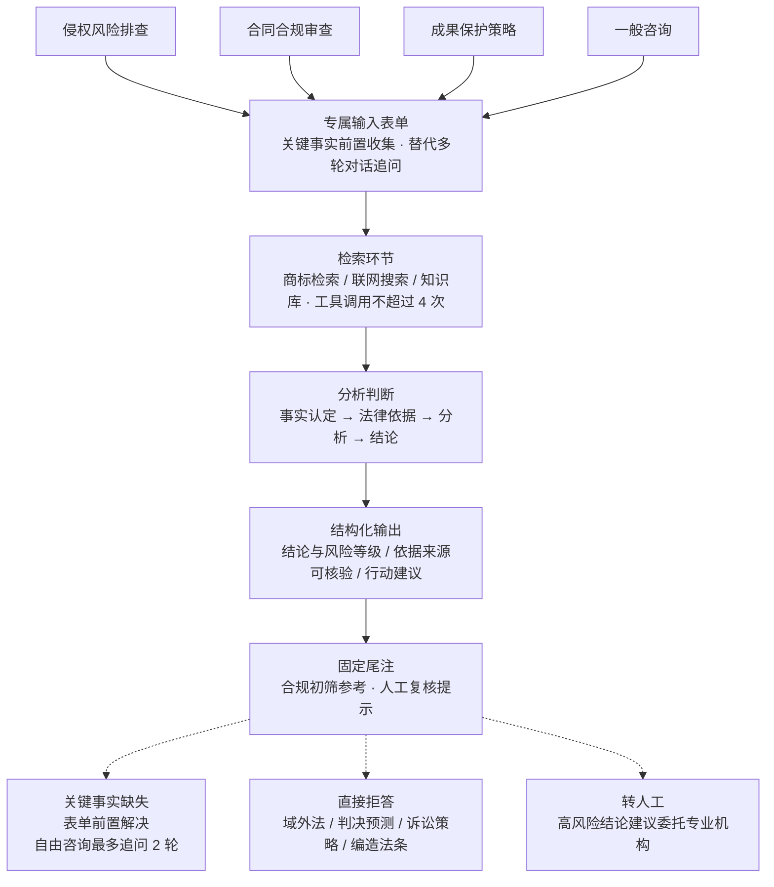

# 小知 · 企业研发合规助手 —— 项目说明

> 这是面向企业研发合规的升级方案。已实现的知识产权合规助理功能见 [当前功能](../product-features.md)，架构与部署见 [开发与部署](../dev.md)。

---

## 1. 项目目标与使用场景

### 给谁用

中小科技企业的**研发团队与法务人员**，尤其是没有专职知识产权律师的初创公司：

- 研发负责人：在立项、研发、成果输出各阶段做初步合规自查；
- 法务人员：用它做第一轮筛查和文书初稿。

不面向执业律师（其场景是办案，本项目定位是企业内部合规前置）。

### 在什么任务中用

| 任务 | 说明 |
| --- | --- |
| 研发立项前侵权风险排查 | 简化 FTO：输入技术方向或产品关键词，输出风险等级与检索报告 |
| 研发成果保护策略 | 该申请专利还是作为商业秘密保护，给出路径建议 |
| 合规检查清单 | 研发全流程（立项→研发→测试→发布→对外合作）检查项生成与勾选 |
| 合同与制度文书初稿 | NDA、竞业限制、职务发明权属约定 |
| 开源许可证合规初筛 | 引入的开源组件与自研代码、拟采用许可证是否冲突 |
| 日常检索 | 查法条、查商标/专利注册状态 |

### 典型输入

- 一段项目/技术描述（如"我们计划研发一款带 XX 功能的智能眼镜"）；
- 一份待审合同（NDA、技术许可合同，上传或粘贴）；
- 一个商标名或技术关键词（用于检索排查）；
- 一份研发成果说明（用于保护策略判断）；
- 一个具体问题（如"开源 GPL 组件能用在我们的商用产品里吗"）。

### 期望输出

- **明确的结论或风险等级**（高/中/低），不是含糊的泛泛而谈；
- **可复核的依据**：法条写明制定机关、法律名称、条文序号；检索到的商标/专利/案例写明来源链接、案号；
- **分析过程**：事实认定 → 法律依据 → 分析 → 结论 的结构化呈现；
- **行动建议**：下一步该做什么（补充检索、修改方案、签署什么文件）；
- 每份输出**末尾固定标注"需人工复核"**。

### 成功标准

1. 对输入的技术方向/商标/合同，能给出**可复核来源的风险提示**，来源链接可点开验证，而不是凭空编造；
2. 对固定测试集（5 个预设场景：商标冲突、开源许可证冲突、职务发明权属、商业秘密泄露、竞业限制）能稳定识别风险类型并给出对应法条依据；
3. 检索不到时**明确说"未检索到，需人工核实"**，而不是编造法条或案号；
4. 合规检查清单覆盖研发全流程阶段，可导出。

---

## 2. 范围与边界

### 覆盖领域

以**商标、著作权（含软件与开源合规）、商业秘密、反不正当竞争**为主；**专利仅做"检索提示"不做侵权比对**——权利要求比对需要专业工具与人工分析，AI 初筛容易给出误导性结论，如实标注这一局限。取舍原则：宁可范围窄而可靠，不做大而不可信。

### 法域

- **仅中国现行有效法律**（法律、行政法规、司法解释、部门规章）；
- 不涉及域外法；涉及域外问题时明确提示"超出本工具覆盖范围，请咨询对应法域专业人士"；
- 检索结果以现行有效版本为准，被修订/废止的旧法不予引用。

### 不做什么（边界声明）

- 不提供正式法律意见，不构成律师-委托人关系，所有输出仅供参考；
- 不替代律师执业判断，不设计诉讼策略、不做管辖与程序建议；
- 不处理未公开的保密信息：界面提示用户对核心商业秘密脱敏后再输入；
- 不做判决结果预测或"官司能不能赢"的承诺；
- 不对专利权利要求做逐一特征比对式侵权认定。

### 时间效力

联网检索优先采信权威来源（国家知识产权局、中国商标网、最高法院官网）并标注检索时间；法条引用要求写明"现行有效"表述；时效存疑的内容统一标注"需进一步核实"。

---

## 3. 核心业务流程

### 流程图

### 设计要点

**① 业务入口用按钮，不做 AI 自动识别**

用户点击四个业务按钮之一（侵权风险排查 / 合同合规审查 / 成果保护策略 / 一般咨询），意图由用户直接声明，零误判；每个按钮绑定专属流程与固定报告模板，输出结构可预期、演示可复现。"一般咨询"保留自由对话作为兜底，避免零碎小问题被迫走完整流程。

**② 追问改为表单前置收集**

关键事实不靠对话追问，靠表单字段在设计阶段定死：

| 业务类型 | 表单收集的关键事实 |
| --- | --- |
| 风险排查 | 产品/技术方向、使用地域、是否已商用 |
| 合同审查 | 合同文本 + 类型（NDA / 许可 / 竞业） |
| 保护策略 | 成果形态（技术方案/代码/设计）、是否已公开 |
| 一般咨询 | 自然语言提问（关键事实缺失时最多追问 2 轮） |

**③ 必须追问的情况**

问题涉及具体判断但缺少关键事实（如"我这个商标能不能注册"却没说类别和含义）——先追问再分析，不基于假设直接下结论。

**④ 直接拒答 / 说明局限的情况**

- 域外法律问题 → 拒答并说明覆盖范围；
- 要求预测判决结果 → 拒答并解释原因；
- 涉及正在审理案件的具体策略 → 拒答，建议咨询承办律师；
- 用户要求编造法条/案例 → 拒答。

**⑤ 转人工的情况**

所有输出的结论性内容固定附"建议人工复核"提示；高风险等级结果（如检索到高度近似商标）时，明确建议"在正式投入前委托代理机构做全面检索"。

---

## 附：系统实现概要

- **Agent 框架**：基于 OpenAI Function Calling 自研的 ReAct 式工具循环（未用 LangChain），模型按需调用工具、后端执行后回填上下文继续生成；
- **模型**：4 个智谱内置模型，并支持用户配置 OpenAI 兼容的自定义模型。请求发往所选模型，失败时提示用户重试或手动切换。
- **前端**：React 19 + Vite 7 + Tailwind CSS 4；
- **后端**：Node.js + Express 4 + TypeScript，SSE 流式输出带心跳保活；
- **数据**：对话、私有知识条目和业务设置按账号存入 CloudBase PG，附件原件保存在私有桶。浏览器保存外观及模型偏好。
- **开源自查说明**：检索不到的内容明确标注"需进一步核实"，全部引用附来源链接，输出固定附人工复核提示。
